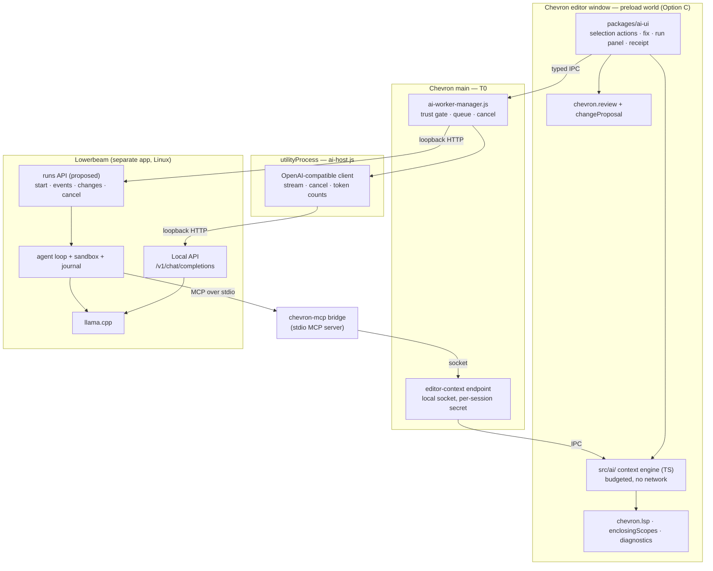

# AI-native Chevron: a local model through Lowerbeam

**Status:** proposed (2026-10-13). Nothing here is built. Owner decisions are in §11.  
**Supersedes:** the deleted `docs/ai-design.md` (removed as undecided in #232; read it with
`git show 24b642f33^:docs/ai-design.md`). §12 says what carries over and what does not.  
**Related:** [next-tracks-plan.md](../process/next-tracks-plan.md) track 3 (agent host),
[change-review.md](../reference/change-review.md), [lsp-design.md](../reference/lsp-design.md),
[chevron-architecture-modernization.md](../reference/chevron-architecture-modernization.md) (A2 rejected a rewrite; §8 here reopens it).

---

## 1. The question

The owner wants Chevron to become an AI-empowered editor whose model runs **locally**, on a
consumer GPU of about 8 GB, through [Lowerbeam](https://github.com/giobuilds/lowerbeam) — the
owner's llama.cpp workbench for small cards. Two questions come with it:

1. What does Chevron need so that a local model makes it a better editor?
2. Is the Atom-shaped core in the way — should it be rewritten first?

First features, in the owner's order of interest: **agent runs** (multi-file edits that can run
the tests), **selection actions** (explain, refactor, write tests), and **fix from diagnostics**.

## 2. Recommendation in one paragraph

**Do not rewrite first.** None of the three features is blocked by the Atom core; every one maps
onto a seam Chevron already has (§7), and a rewrite would delay all of them by its own length
while shipping nothing. **Split the work by what each project already does well:** Lowerbeam owns
the model and the agent loop; Chevron owns editor context, review, trust and the UI. They meet over
three protocols — OpenAI-compatible HTTP for the model, MCP for Chevron's context, and a
Lowerbeam *runs* API for agent jobs. **Everything new lives outside the renderer**, so if a
rewrite is ever justified (§8 says how we would know), the AI layer survives it.

---

## 3. What 8 GB actually allows

The hardware is the design constraint, not a detail. Figures below are Lowerbeam's, measured on an
RX 6600 8 GB (its README):

| Fact | Consequence for Chevron |
|------|-------------------------|
| A 9B at Q4_K_M fits **fully on the GPU with a 16k context** | The whole request — instructions, context, the reply, and any reasoning — has to fit in roughly 16k tokens. Less when the server has several slots: each concurrent request gets `--ctx-size ÷ --parallel` |
| Reasoning models spend that same budget thinking | A request that sends 12k tokens of context can leave the model no room to answer. Context must be **chosen**, not collected |
| Lowerbeam's reference loop on Ornith-1.5-9B: **29/30** read-only tasks, **22/30** write tasks (round cap lifted to 40; the app keeps 12) | Agents on this hardware are useful and **not reliable**. Every edit goes through human review; single-shot features ship first because they fail small |
| llama.cpp decodes one sequence per slot | Requests queue. Chevron must prioritise what the user is waiting for and cancel what they abandoned |
| How much context fits depends on **free VRAM** at launch | Chevron's own Chromium GPU process competes with the model for the same card. Unmeasured today — see §7.7 |
| Lowerbeam ships for **Linux x86_64 only** | Chevron ships macOS and Windows too. The model endpoint must be generic (any OpenAI-compatible server: llama-server, Ollama); Lowerbeam is the recommended backend, not a requirement. Agent runs (§6.3) are Linux-only until Lowerbeam is not |

**The design consequence:** large-context editors send the model whole files and let it sort them
out. On 16k tokens that does not work. Chevron's job is to be a **precise context engine** — send
2–4k tokens of exactly the right code: the enclosing function, the types it touches, the error it
has, the call sites that matter. Chevron is unusually well placed for that, because the parts are
already built and already out of the hot path:

| Context source | Where it is |
|----------------|-------------|
| What encloses a line (function, class, block) | `chevron.enclosingScopes` — `src/enclosing-scopes.ts`, tree-sitter folds, cached |
| Types, definitions, references, project symbols | `chevron.lsp` — LSP host in a `utilityProcess` (`src/lsp/`, `workers/lsp-host.js`) |
| Current errors | `lsp.diagnostics` service |
| Fast text search | ripgrep spawned from main (`register-rg-ipc.js`) |
| Unsaved edits | open `TextBuffer`s — which no outside agent can see |

That last row matters: an agent that reads files from disk sees the code as of the last save. The
editor is the only party that knows what the user is looking at **now**.

---

## 4. Who owns what

Lowerbeam already has a measured, small-model-tuned coding agent: an inspect / edit-in-a-copy /
run-in-a-bubblewrap-box loop, a journal written before every side effect, grants that confine every
path, bounded tool output sized to the window, and structured compaction. Chevron has diff review
with content-located hunks and one-step undo, LSP, tree-sitter, trust, a terminal and tasks.
Building a second agent loop in Chevron would duplicate the hardest half of Lowerbeam — and the
next-tracks plan already said why not: *fork the integration, not the runtime*.

| Concern | Owner | Why |
|---------|-------|-----|
| Model process, fit, VRAM, router, launch settings | **Lowerbeam** | Its entire purpose |
| Agent loop, compaction, journal | **Lowerbeam** | Measured against a harness; tuned to 8 GB windows |
| Running commands an agent asks for | **Lowerbeam** (bubblewrap box, no network, copy only) | Stronger than anything Chevron has: Chevron's pty host runs commands as the user, gated only by project trust |
| Editor context (buffers, selection, LSP, scopes, diagnostics) | **Chevron** | Only the editor has it live |
| Single-shot requests (selection actions, fix) | **Chevron** | No loop needed — one prompt, one reply, one proposal |
| Review, apply, undo | **Chevron** (`chevron.review`) | Edits land in open buffers as one transaction; unsaved work is respected |
| Trust | **Both** — Chevron's project trust gates any AI on a root; Lowerbeam's grant gates what a run may touch | Each enforces its own boundary; neither trusts the other's UI |
| UI | **Chevron** | The point of the integration |

**One overlap to resolve deliberately:** Lowerbeam can apply a run's changes to the project
itself (writing files only if they still hold what the copy started from). When a run is started
from Chevron, Chevron should apply instead — through `chevron.review`, into open buffers — and
Lowerbeam's copy is just the staging area. Otherwise an agent writes files underneath an editor
that has them open and modified.

---

## 5. Target architecture

### Invariants (carried from the deleted design, still right)

1. **No network and no keys in the renderer.** The renderer composes a request; `ai-host` sends
   it. A package, or script injected into the editor, can neither read the Lowerbeam key nor reach
   the endpoint directly.
2. **Model output is never executed by Chevron.** Text is rendered; edits become proposals; only
   a person applies them. Commands an agent wants run happen in Lowerbeam's box, not Chevron's pty.
3. **Off by default, absent when off.** With AI disabled, Chevron makes no AI connections at all —
   asserted on sockets, not on UI.
4. **The user can see what was sent.** A context receipt lists exactly the text in a request. Even
   on loopback: Lowerbeam can be configured to listen on the LAN, and "what did the model see" is
   the first question when an answer is wrong.

### New pieces

| Piece | Where | Shape it copies |
|-------|-------|-----------------|
| `ai-host.js` | `src/main-process/workers/` (JavaScript — main-side code cannot load `.ts`; see `src-typescript-first.test.js`) | `lsp-host.js`: supervised `utilityProcess`, restart with backoff |
| `ai-worker-manager.js` | `src/main-process/` | `lsp-worker-manager.js` |
| IPC channels `chevron:ai-*` | `register-renderer-ipc.js`, validated, listed in `script/ci/ipc-inventory.json` | the `chevron:lsp-*` channels |
| Context engine | `src/ai/` (TypeScript) | pure functions, `node:test`-tested like `change-proposal.ts` |
| Reference UI | `packages/ai-ui` | `packages/lsp-ui` — replaceable, consumes services |
| Editor-context bridge | main-side socket + a `chevron-mcp` stdio entry | the CLI socket `atom-application.js` already runs (hashed secret path, stale-socket sweep) |

---

## 6. The three features

### 6.1 Selection actions — explain, refactor, write tests

1. The user selects code and picks an action.
2. The context engine builds, within budget: the selection; its enclosing scope
   (`enclosingScopes`); hover types for identifiers it uses (`chevron.lsp`); the file's import block.
   Anything over budget is dropped outermost-first, and the receipt says what was dropped.
3. `ai-host` streams the reply. **Explain** renders it in a panel.
4. **Refactor** and **write tests** ask for an edit in a constrained format. llama-server decodes
   under a JSON schema or GBNF grammar, so a small model *fills* a format rather than *writing* one
   (Lowerbeam's `structuredOutput.ts` is the precedent). The reply becomes
   `chevron.changeProposal.proposeChange(...)` → `chevron.review.propose(...)`.

Review already locates hunks by their content, not their line number, and reports a hunk it cannot
place instead of writing it in the wrong spot ([change-review.md](../reference/change-review.md)).
That matters more for AI than for anything else: a local model is slow enough that the user will
have typed while it answered.

**Edit format is a measurement, not a choice.** Search/replace blocks (what Lowerbeam's `edit_file`
uses: the `find` text must match exactly once) versus whole-scope replacement — decide with
Lowerbeam's harness on the owner's models, not by preference.

### 6.2 Fix from diagnostics

1. Cursor on a diagnostic → "Fix with AI".
2. Context: the diagnostic message and range, the enclosing scope, the definitions of symbols on
   the failing line (LSP go-to-definition, trimmed to their signatures).
3. Reply → proposal → review.
4. **After apply, re-read the diagnostics.** The language server is a free verifier: the panel says
   whether the error cleared. That is the cheapest honest signal a small model's fix can get, and it
   needs no command execution.

This is the feature where Chevron's semantics pay most: the useful context for an error is almost
never "the file", and LSP knows exactly which other code is involved.

### 6.3 Agent runs

**Delegated to Lowerbeam, reviewed in Chevron.**

1. In a trusted project, the user starts a run: task text, mode (inspect / edit / edit-and-run).
2. Chevron asks Lowerbeam's runs API to start it on the project root. Unsaved buffers are a
   precondition problem: either save first or refuse with a reason — never let a run work from a
   disk state the user has already changed.
3. Lowerbeam's journal events stream into a Chevron panel: reads, searches, refusals, commands
   and their exit codes, the answer.
4. When the run ends, Chevron fetches its changes (per-file before/after) and opens them in
   `chevron.review` as one multi-file proposal. Accepted hunks apply to buffers in one transaction;
   one undo takes them back.
5. Lowerbeam's evidence (the last test run after the last edit, against the same command before any
   edit) is shown beside the review, so "the tests pass" is a record, not the model's claim.

**Then make the agent smarter with Chevron's context (§9, step P5).** Lowerbeam's tools today are
list, search, read, and optionally embedding `find`. With Chevron's MCP bridge granted to a run,
the agent also gets `definition`, `references`, `diagnostics`, `enclosing_scope` and
`open_buffers` — answers from a language server instead of text search. On a 16k window that is
the difference that counts: each read a symbol lookup replaces is several thousand tokens kept.

**What Chevron does not do:** run the agent loop, execute commands for it, or give it raw
filesystem access. If Lowerbeam is not available (macOS, Windows, or not installed), agent runs
are unavailable and say why; §6.1 and §6.2 still work against any OpenAI-compatible endpoint.

---

## 7. What actually changes in Chevron

This is the modernisation the AI work needs. It is real work, and none of it is a rewrite.

1. **A third supervised host.** `ai-host` joins the git workers and the LSP host. The pattern,
   its failure modes and its tests exist; #309 is the reminder that a host can look alive and do
   nothing, so the gate is a round trip through a real host process against a fake server.
2. **A budgeted context engine** in `src/ai/`. The model's window (from `/props` or `/v1/models`)
   is an input to every request, and token counts come from the server's own figures
   (`timings.prompt_n`), never an estimate.
3. **A typed editor-context API.** `chevron.lsp`, `chevron.enclosingScopes` and the diagnostics
   service become one versioned surface with TypeScript declarations, usable in process (by
   `ai-ui`) and over MCP (by an agent). This is the modern part of the change: a typed contract
   instead of reaching into `AtomEnvironment`.
4. **Review for outside proposers.** Multi-file proposals carrying provenance (which model, which
   run) and a "this run is stale" state when the project moved since the run started.
5. **A gate in main, not in a package.** Packages have full Node (Option C), so a gate inside a
   package is one a package can bypass. Trust, queueing and cancellation live in
   `ai-worker-manager`.
6. **A local endpoint for the MCP bridge**, authenticated by a per-session secret, on the same
   pattern as the existing CLI socket. Read-only tools only; nothing on it can write or run.
7. **Leaving the GPU to the model — measure first.** Chromium's GPU process holds VRAM that
   llama.cpp could have used for context. Measure what Chevron holds with hardware acceleration on
   and off, on the 8 GB card, with a large file open. If it is material, a setting that disables
   hardware acceleration (a text editor renders acceptably in software) is a direct trade of
   editor smoothness for model context, and the user should be offered it.
8. **State that survives reload.** A run's state is Lowerbeam's journal; the panel is a projection
   of it. Closing or reloading a Chevron window loses nothing, because the renderer never owned it.

What is **not** needed: `sandbox: true`, a new package model, a new process topology for the
editor, or any change to how packages load.

---

## 8. The rewrite question, reopened

The modernization doc rejected a rewrite (A2) for lack of a reason. The owner has reopened it, so
here it is weighed against this goal specifically.

What would be thrown away or redone: `src/` is ~72,000 lines (`TextEditor` 5,900 and its
component 5,400 of them); the 93 bundled packages are ~91,000 lines of library code (`github` alone
is 44,000); 145 `node:test` files gate it.

| Option | What it is | Buys for the AI goal | Costs | Verdict |
|--------|-----------|----------------------|-------|---------|
| **R0** | Keep the core; build §5–§7 | Everything in §6 | Weeks to the first feature; months to agent runs | **Recommended** |
| **R1** | Replace the **renderer** (e.g. CodeMirror 6 in the same Electron shell); keep main, the LSP / git / pty / rg hosts, trust, `change-proposal` | Nothing §6 needs — but a smaller, typed renderer if the tripwires below fire | Most of `src/` and every package's view; a year or more for one person to regain parity on the packages that matter | **The shape of any rewrite**, if one is ever justified |
| **R2** | Native rewrite (Rust/GPU, or the Avalonia spike) | Lower memory; perhaps less VRAM | A second product; everything above, plus the main process | Rejected — Zed already occupies that space, and Lowerbeam, built for the same 8 GB card, is itself an Electron app |
| **R3** | Fork Zed or Code-OSS, which already speak to local models | A head start on AI UI | Fork maintenance at their pace — the drift this repo measured (29 of 83 forks) at a far faster upstream; loses everything Chevron is | Rejected |

**Why R0 first even if a rewrite comes later:** §5 puts the model client, the gate, the context
API's protocol and the agent integration **outside the renderer**. An R1 renderer would plug into
the same hosts and the same protocols. Doing AI first makes a later rewrite smaller; doing the
rewrite first makes AI wait for all of it.

**Tripwires — reopen R1 if any of these is measured:**

| Tripwire | Measured how |
|----------|--------------|
| Chevron's VRAM use cannot be brought low enough to leave the model its context, without unacceptable rendering | §7.7 measurement |
| Streaming tokens or live decorations push keystroke-to-paint past a frame on ordinary files | the package profiler (next-tracks track 1) |
| The typed context API (§7.3) cannot be built without packages reaching through `AtomEnvironment` internals | the attempt itself, in P4 |
| An AI feature the owner wants cannot be expressed with decorations, panels and review | a written case, with the feature named |

---

## 9. Phased PR plan

Each step is a release on its own; stopping after any of them leaves a working editor. Every new
test goes in `script/ci/` and on its own line in `.github/workflows/ci.yml`
(`ci-runs-every-test.test.js` fails otherwise). A shipped step gets a `docs/reference/` page.

| Step | Outcome | Gate | Needs from Lowerbeam |
|------|---------|------|----------------------|
| **P0** spike | `ai-host` + manager + OpenAI-compatible streaming client; a command that explains the selection and logs the stream. Endpoint and key from config; key stored with `keytar` | round trip through a real host process against a fake server; cancel mid-stream ends the request | Nothing — today's Local API |
| **P1** selection actions | context engine, `packages/ai-ui`, receipt, explain / refactor / write tests, proposals into review | `ai-context-budget.test.js` (never over budget, drops outermost first); `ai-egress.test.js` (renderer cannot connect; AI off means zero sockets); smoke: propose → review → undo through a fake server | Nothing |
| **P2** fix from diagnostics | "Fix with AI" on a diagnostic; post-apply re-check | smoke with a mock language server: diagnostic → proposal → applied → diagnostic cleared | Nothing |
| **P3** VRAM measurement | numbers for §7.7; a setting only if they justify one | a written measurement in `docs/reference/` | Nothing |
| **P4** typed context API + MCP bridge | `definition`, `references`, `diagnostics`, `enclosing_scope`, `open_buffers` over MCP, read-only | MCP round trip against a live editor in smoke; a write-shaped call is refused | Nothing to build it; MCP in coding runs to use it |
| **P5** agent runs | run panel, journal stream, multi-file review, evidence | end-to-end against Lowerbeam's fake server fixtures: start → events → changes → review → apply → undo | **A runs API** (§10) |

P0–P4 need nothing from Lowerbeam beyond the Local API it ships today, so Chevron's side is not
blocked on Lowerbeam's engine work.

---

## 10. The Lowerbeam contract

What Chevron needs, and whether it exists:

| Need | Lowerbeam today | Proposal |
|------|-----------------|----------|
| OpenAI-compatible streaming chat | **Yes** — the Local API is llama-server itself | — |
| Fixed port, key, loopback by default | **Yes** — LAN only when asked for, and only with a key | — |
| The window a request will get | via llama-server `/props` | Prefer a Lowerbeam-level answer that already accounts for slots |
| Exact token counts | **Yes** — `timings` on every response | — |
| Constrained output (JSON schema, GBNF) | **Yes** — passed through to llama-server | — |
| Cancellation | closing the stream | Confirm a closed stream frees the slot immediately |
| Discovering port and key without copy-paste | No | A file in Lowerbeam's app data, readable only by the user, naming the port and where the key is |
| Starting a coding run from another program | **No.** Runs start from the app or `lowerbeam run` | A runs API on the engine: start (project, task, mode, grants), an event stream (the journal), changes (per-file before/after), cancel. `CodingSupervisor` and `headless.ts` already have this shape in process |
| An editor's tools inside a run | No — MCP is not offered to coding runs yet | Per-grant MCP in runs, with Chevron's bridge as the first server |

The runs API is the one real ask: it turns running a coding job for another program from
something Lowerbeam does not offer into a supported, granted operation. It belongs to Lowerbeam's
roadmap and the owner's call (§11.3).

---

## 11. Decisions for the owner

1. **Rewrite:** accept R0 with the §8 tripwires, or fund an R1 spike now.
2. **Agent ownership:** Lowerbeam runs the loop (recommended), Chevron builds its own on the model
   API, or both share a library extracted from Lowerbeam's `src/agent` + `src/context`.
3. **Lowerbeam runs API:** add it on Lowerbeam's side, where coding runs are today started only
   from its own window or `lowerbeam run`.
4. **Sequencing:** P0–P4 need only the Local API Lowerbeam ships today. Start them now, or wait
   until Lowerbeam's headless work has settled?
5. **Other endpoints:** support any OpenAI-compatible server (Ollama, plain llama-server) for
   §6.1–6.2 on every platform, or Lowerbeam only?
6. **Cloud providers:** the deleted design treated Anthropic and OpenAI as peers. This one is
   local-first and names none. Keep it that way, or leave the adapter open?
7. **Edit format** for small models (§6.1): settle it by running Lowerbeam's harness on both formats.

---

## 12. What carries over from the deleted design

| Kept | Changed |
|------|---------|
| The host-process invariant: network and keys only in a `utilityProcess` | Local-first. Cloud providers, per-request cost and budgets are out of scope |
| Off by default; zero traffic when off | **Agents are no longer a non-goal.** Its §6.4 required workspace trust, an action allowlist and per-action confirmation before agents; Lowerbeam's grant, copy and sandbox answer those, and Chevron adds trust and review on top |
| Context receipt | The redactor is demoted: on loopback the concern is what the model sees, not who receives it. Lowerbeam's own exclusions (keys, `.env` at any depth) apply to runs |
| Never execute model output | Context tiers are replaced by a **budget**: with a 16k window, the question is not "how much may I send" but "what is worth sending" |
| Model output becomes reviewable diffs | Inline completion is not in this plan; the owner did not pick it, and its always-on traffic changes the privacy bargain |
